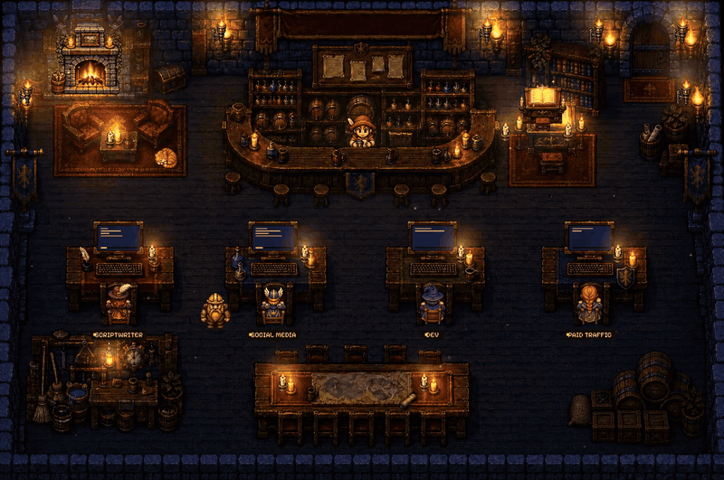
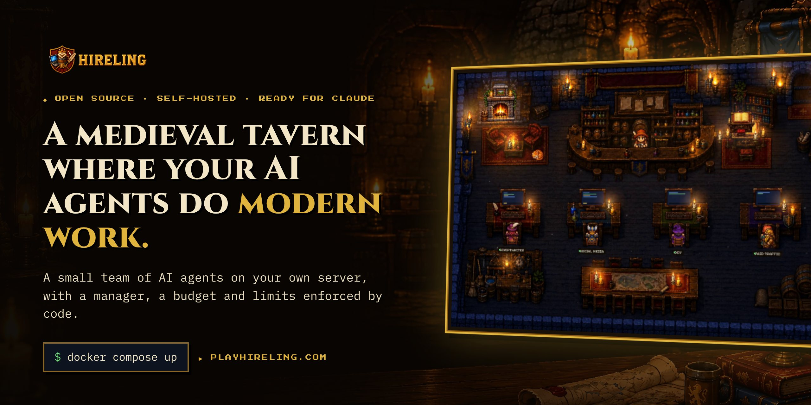
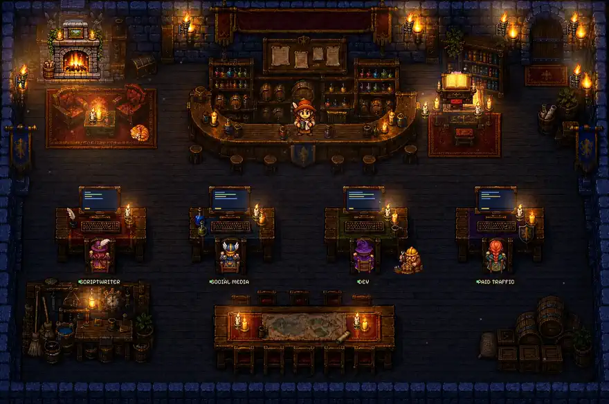
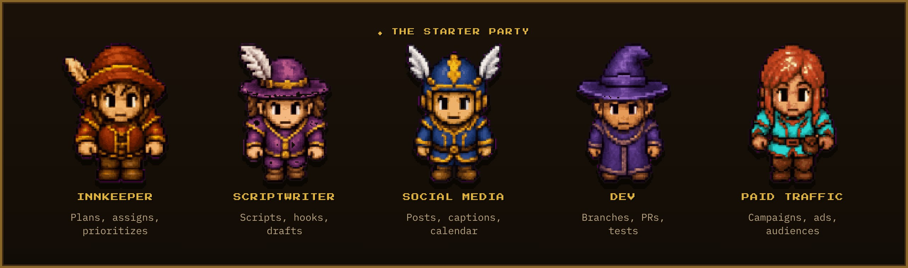

<p align="center">
  <a href="https://playhireling.com/play/"></a>
</p>

<p align="center">
  <a href="https://playhireling.com"></a>
</p>

<p align="center">
  <a href="https://github.com/Play-Hireling/hireling/actions/workflows/ci.yml"></a>
  <a href="LICENSING.md"></a>
  
  
  <a href="docs/guides/claude-code.md"></a>
</p>

<p align="center">
  <b><a href="https://playhireling.com/play/">▶ Play the demo</a></b> ·
  <a href="docs/getting-started/quickstart.md">Quickstart</a> ·
  <a href="docs/README.md">Docs</a> ·
  <a href="docs/roadmap.md">Roadmap</a> ·
  <a href="https://playhireling.com">Website</a>
</p>

Run a small team of AI agents — the *hirelings* — on your own server. They take orders, split work, talk to each other at the bar, share files on the common table, remember what they learned in a shared ledger, and **stop to ask you before anything irreversible**.

<p align="center">
  <a href="https://playhireling.com/play/"></a><br>
  <sub>The tavern at night. Every desk is a hireling in its own container; the Innkeeper plans at the bar. <a href="https://playhireling.com/play/">Play it in your browser →</a></sub>
</p>

---

## Why Hireling

Multi-agent setups are easy to demo and hard to run all day. Hireling is the boring, durable part:

- **One manager, one goal.** The **Innkeeper** turns your request into tasks with an owner, a priority and an expected contribution to the tavern's single **quest**. Hirelings never reorder work among themselves.
- **Isolation by default.** One container, one private volume and one set of secrets per hireling. They share only the bar (messages), the common table (files) and the Ledger (memory).
- **Autonomy that is enforced, not requested.** Every action is *free*, *capped* or *the owner decides*. Payments, contracts, deletions and production changes always become a card on **Waiting on you**. Silence means *wait*, never *go*.
- **No open internet.** Hirelings sit on an internal network; the only door out is an egress proxy that allows each one exactly the hosts in its profile.
- **Costs you can read.** Every turn's tokens and cost are recorded per hireling, per day, against a budget ("mana").
- **Cheap enough to run all day.** DeepSeek V4-Flash for the workers, V4-Pro for the one hireling that plans, the same model on OpenRouter as automatic fallback. More OpenAI-compatible providers are on the [roadmap](docs/roadmap.md).
- **Ready for Claude.** A plain HTTP API and a shell CLI, so Claude Code (or any agent) can run your tavern from a terminal, plus a [Tavern MCP server](docs/guides/claude-code-mcp.md) for MCP clients.

> The game client — the pixel-art tavern where you watch the party work — is played at [playhireling.com/play](https://playhireling.com/play/). This repository is the engine underneath it.

## Quickstart

Self-host of the engine and the panel; the game on self-host comes next. The public demo is at [playhireling.com/play](https://playhireling.com/play/). You need Docker with Compose v2 and a [DeepSeek API key](https://platform.deepseek.com/).

```bash
git clone https://github.com/Play-Hireling/hireling.git && cd hireling
./scripts/init-env.sh                 # creates .env with random Front Desk tokens
${EDITOR:-nano} .env                  # set DEEPSEEK_API_KEY=sk-…  (never commit .env)
./scripts/preflight.sh                # exit 0, or run the iptables-legacy command it prints
docker compose up -d --build          # Innkeeper + Scriptwriter + Dev

curl -fsS http://127.0.0.1:8080/healthz   # {"status":"ok",...}
# Owner panel (not the pixel-art tavern): http://127.0.0.1:8080/

./bin/tavern order innkeeper "Plan a launch post for our new feature, due Friday"
./bin/tavern status                   # who is doing what
./bin/tavern decisions                # what is waiting on you
```

Full walkthrough, profiles and troubleshooting: **[docs/getting-started/quickstart.md](docs/getting-started/quickstart.md)**. A clean run of that default path, from zero images, took 95 s ([evidence](docs/evidence/quickstart-run.md)).

The pixel-art client is not published. Until the license holder ([PENDENTE TITULAR](LICENSE-CLIENT.md)) decides to publish an image, build one locally and point Compose at that tag. Profile `game` does not start without `HIRELING_CLIENT_IMAGE`.

```bash
# in a checkout of Play-Hireling/playhireling, on main:
npm run build:selfhost
# then, in this repository:
scripts/pack-client.sh /path/to/playhireling/dist-selfhost   # hireling/client:local, not pushed
HIRELING_CLIENT_IMAGE=hireling/client:local docker compose --profile game up -d --build
# http://127.0.0.1:8080/tavern/
```

## How it works

```text
            you ──► bin/tavern / any HTTP client / Claude Code
                         │  Front Desk API (owner token)
                         ▼
 ┌───────────────────────────── tavern-core ─────────────────────────────┐
 │  Front Desk · tasks + leases · quest · budgets · policy gate · events │
 └───────────────┬───────────────────────────────────────────────────────┘
                 │ HTTP (internal)          Redis Streams = "the bar"
     ┌───────────┼────────────┬────────────────────┐
     ▼           ▼            ▼                    ▼
 innkeeper   scriptwriter    dev       …   (one container each: Hermes + `hireling`)
     │           │            │
     └── /tavern/shared (the common table) ── Tavern Ledger (GBrain, optional)
                 │
                 ▼
             egress proxy ──► only the hosts each profile allows
```

| Piece | What it is | Path | License |
| --- | --- | --- | --- |
| `hireling` runtime | The loop inside every hireling container: profile → Hermes config, Front Desk queue, the bar, plans, handoffs, decisions, usage, redaction | [`runtime/`](runtime/) | Apache-2.0 |
| tavern-core | Tasks with leases, priorities, the quest, budgets, the policy gate and the Front Desk | [`services/tavern-core/`](services/tavern-core/) | FSL-1.1-ALv2 |
| egress | Per-hireling host allowlist proxy | [`services/egress/`](services/egress/) | Apache-2.0 |
| tavern-mcp | The owner's console as an MCP server (stdio) for Claude Code and other MCP clients | [`services/tavern-mcp/`](services/tavern-mcp/) | Apache-2.0 |
| ledger-writer + GBrain | The shared memory: typed markdown pages in git, keyword search over MCP | [`runtime/cmd/ledger-writer`](runtime/cmd/ledger-writer), [`services/gbrain/`](services/gbrain/), [`ledger/`](ledger/) | Apache-2.0 |
| Starter party | Profiles and prompts of six hirelings | [`agents/`](agents/) | Apache-2.0 |

Read [docs/architecture.md](docs/architecture.md) for the full picture and [docs/concepts/](docs/concepts/) for each idea.

## Meet the party

<p align="center"></p>

| Hireling | Model | Does | Never does without you |
| --- | --- | --- | --- |
| **Innkeeper** | DeepSeek V4-Pro | Splits requests into tasks, assigns, prioritizes, approves handoffs | Hiring, firing, budget caps |
| **Scriptwriter** | V4-Flash | Video scripts, hooks, outlines, blog and newsletter drafts | Publishing under your name |
| **Dev** | V4-Flash | Branches, PRs, tests, rollbacks | Production merges, shared-data migrations |
| **Social Media** | V4-Flash | Posts, carousels, captions, calendar | Paid boosts, partner channels |
| **Paid Traffic** | V4-Flash | Campaign plans, audiences, ad copy | Spending above the cap (starts at zero) |
| **Test** | V4-Flash | Proves the plumbing | — |

Add your own in minutes: [docs/guides/add-a-hireling.md](docs/guides/add-a-hireling.md).

## Documentation

- **Start:** [Quickstart](docs/getting-started/quickstart.md) · [Your first order](docs/getting-started/first-order.md) · [FAQ](docs/faq.md)
- **Concepts:** [The tavern](docs/concepts/tavern.md) · [Hirelings](docs/concepts/hirelings.md) · [The bar](docs/concepts/the-bar.md) · [Quest and tasks](docs/concepts/quest-and-tasks.md) · [Autonomy and decisions](docs/concepts/autonomy.md) · [The Ledger](docs/concepts/ledger.md)
- **Guides:** [Add a hireling](docs/guides/add-a-hireling.md) · [Models and providers](docs/guides/models.md) · [Accounts (Composio)](docs/guides/accounts.md) · [Turn on the Ledger](docs/guides/ledger.md) · [Run it with Claude Code](docs/guides/claude-code.md) · [Claude Code over MCP](docs/guides/claude-code-mcp.md) · [Deploy to a server](docs/guides/deploy.md)
- **Reference:** [CLI](docs/reference/cli.md) · [Configuration](docs/reference/configuration.md) · [Profile schema](docs/reference/profile.md) · [Front Desk API](docs/api/front-desk.md) · [tavern-core API](docs/api/tavern-core.md) · [Feature ids](docs/reference/feature-ids.md)
- **Project:** [Architecture](docs/architecture.md) · [Security](docs/security.md) · [Licensing](LICENSING.md) · [Roadmap](docs/roadmap.md) · [Contributing](CONTRIBUTING.md)

## Hosted Hireling

Don't want to run servers? **Hireling Cloud** hosts your tavern with the full pixel-art game, more hirelings, screens, a branded tavern for your company and support. Join the early-access list at **[playhireling.com](https://playhireling.com)**.

## Community

- **Questions and ideas:** [GitHub Discussions](https://github.com/Play-Hireling/hireling/discussions)
- **Bugs and feature requests:** [Issues](https://github.com/Play-Hireling/hireling/issues/new/choose)
- **News, demos and build-in-public:** [playhireling.com](https://playhireling.com)

If Hireling is useful to you, a ⭐ helps other people find it.

## Contributing

Issues and pull requests are welcome — start with [CONTRIBUTING.md](CONTRIBUTING.md). Good first contributions: new hireling templates in `agents/`, docs, tests. Security reports go to [SECURITY.md](SECURITY.md), not to issues.

## License

Hireling is **fair source**: free to use, read, modify and self-host.

- `runtime/`, `services/egress/`, `services/gbrain/`, `services/ledger-writer/`, `agents/`, `ledger/`, scripts and docs: **[Apache-2.0](LICENSE)**.
- `services/tavern-core/`: **[FSL-1.1-ALv2](services/tavern-core/LICENSE.md)** — use it for anything except offering a competing hosted service; each version becomes Apache-2.0 two years after release.

"Hireling", the logo and the official game art (including the images in [`docs/assets/`](docs/assets/)) are trademarks and are not covered by these licenses — see [TRADEMARKS.md](TRADEMARKS.md). Details in [LICENSING.md](LICENSING.md).
